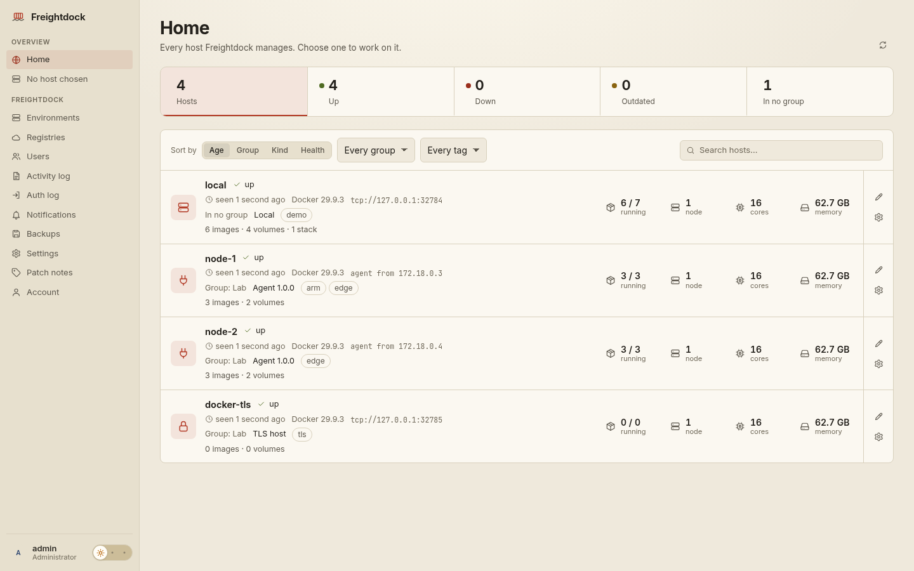

<p align="center"></p>
<h1 align="center">Freightdock</h1>

<p align="center">
  A Docker management UI for people who are staying on Docker.<br>
  One small container. Everything free. Set up in a minute.
</p>

<p align="center">
  <a href="docs/install.md"><b>Install it</b></a>: one container, a minute, the setup token and trusting its certificate.<br>
  <a href="docs/README.md"><b>Read the docs</b></a>: hosts, stacks, roles, single sign-on, backups and the API.
</p>

<p align="center">
  <a href="https://github.com/freightdock/Freightdock/releases/latest"></a>
  <a href="https://github.com/freightdock/Freightdock/pkgs/container/freightdock"></a>
  <a href="https://github.com/freightdock/Freightdock/actions/workflows/ci.yml"></a>
  <a href="LICENSE"></a>
</p>

<p align="center">
  <picture>
    <source media="(prefers-color-scheme: dark)" srcset="docs/screenshots/home-dark.png">
    
  </picture>
</p>

> **How Freightdock is built: with AI assistance.** Most of the code here was written by Claude Code, working from the
> maintainer's design decisions and reviewed before it landed. Every change is written test-first, and the unit tests
> and an end-to-end suite against a real Docker daemon run in CI on every push. Said plainly because you should know
> what you are running; the responsibility for this code is the maintainer's, not a model's.

## Why Freightdock

Portainer has gone Kubernetes-first, and the parts of it worth paying for sit behind a licence key and a node limit.
Freightdock is for everybody who just runs Docker: one small Rust program with its web UI and its database built in, that
means to do what Portainer's Business Edition does for Docker, all of it free. No licence key, no node limit, no paid
tier, ever.

## What you get

- **Containers, all of them**: create, edit, recreate, logs, a console, live stats; images, volumes, networks and events.
- **Stacks**: Compose files written here, pulled from Git and kept in step, or adopted from wherever they started.
- **More hosts**: add one through a small agent that dials home, or over Docker's TLS port; groups, tags, and every host
  on one Home page. **Swarm** too: services, nodes, secrets and configs.
- **Registries** with saved sign-ins and a browser: Docker Hub, GHCR, your own Forgejo or Gitea, and the rest.
- **Templates** in Portainer's format, plus your own, and **webhooks** to redeploy from CI.
- **Single sign-on** with OpenID Connect (Authentik, Keycloak, Entra ID) or LDAP, users, teams and roles, two-factor.
- **Coming from Portainer?** Bring your stacks and hosts across.
- **The activity log**: every change, who made it and from where. **Backups** of Freightdock itself, encrypted, and
  **notifications** when something needs you.
- **An MCP server** for AI agents, with tokens of their own and nothing they may not do.
- **HTTPS from the first start**, with a certificate of its own, or yours.

Kubernetes is not on the list, and never will be.

## Get started

You need Docker.

```sh
docker run -d --name freightdock --restart unless-stopped \
  -p 7443:7443 -p 7444:7444 \
  -e TZ=Europe/London \
  -v /var/run/docker.sock:/var/run/docker.sock \
  -v freightdock:/data \
  ghcr.io/freightdock/freightdock:latest

docker exec freightdock freightdock setup-token
```

<details>
<summary><b>Want Compose?</b></summary>

Save this as `docker-compose.yml` in a folder of its own (the repository's
[`docker-compose.yml`](docker-compose.yml) is the same, with the optional settings written out):

```yaml
services:
  freightdock:
    image: ghcr.io/freightdock/freightdock:latest
    container_name: freightdock
    restart: unless-stopped
    ports:
      - "7443:7443" # the web UI and the API
      - "7444:7444" # where agents on other hosts connect; leave it out if Freightdock manages this host alone
    environment:
      TZ: Europe/London
    volumes:
      - /var/run/docker.sock:/var/run/docker.sock
      - freightdock:/data

volumes:
  freightdock:
```

Then, in that folder:

```sh
docker compose up -d
docker exec freightdock freightdock setup-token
```

To update later: `docker compose pull && docker compose up -d`.

</details>

Open **https://your-server:7443**, paste the setup token and make the first administrator; the local Docker is already
there. [Install](docs/install.md) has Compose, image tags, a reverse proxy, your own certificate and upgrading;
[add a Docker host](docs/agent.md) puts the next machine in.

**Mind the socket.** Whoever can use Docker's socket is root on that host, and so is anybody who signs in to Freightdock as
an administrator. Keep it off the open internet.

## Documentation

All of it is in [`docs/`](docs/README.md):

- [Install](docs/install.md), [add a Docker host](docs/agent.md), [backups](docs/backups.md),
  [running it safely](docs/security.md)
- [Stacks, webhooks and templates](docs/stacks.md), [registries](docs/registries.md), [Swarm](docs/swarm.md)
- [Users, teams and roles](docs/access.md), [single sign-on](docs/sso.md), [API tokens and MCP](docs/api-and-mcp.md)
- [Coming from Portainer](docs/portainer.md), [troubleshooting](docs/troubleshooting.md), and the
  [patch notes](CHANGELOG.md)

Found a bug or have an idea? [Open an issue](https://github.com/freightdock/Freightdock/issues/new/choose); found a security
problem? [Report it privately](SECURITY.md). Working on Freightdock itself: [CONTRIBUTING.md](CONTRIBUTING.md). Everyone
taking part follows the [code of conduct](CODE_OF_CONDUCT.md).

## Licence

Freightdock is free software under the [GNU General Public License v3.0](LICENSE) only. You may use, study, share and change
it; if you distribute a changed version, it has to stay under the same licence with its source available. It comes with
no warranty.

Its UI is built on [FinUI](https://github.com/finstats/finui) and [FinMotion](https://github.com/finstats/finmotion)
(GPL-3.0-only); the fonts are under the SIL Open Font License 1.1, their licences in `web/assets/finui/fonts/`.

<sub>Screenshots show a throwaway Freightdock on throwaway Docker daemons, with invented hosts and containers.</sub>
